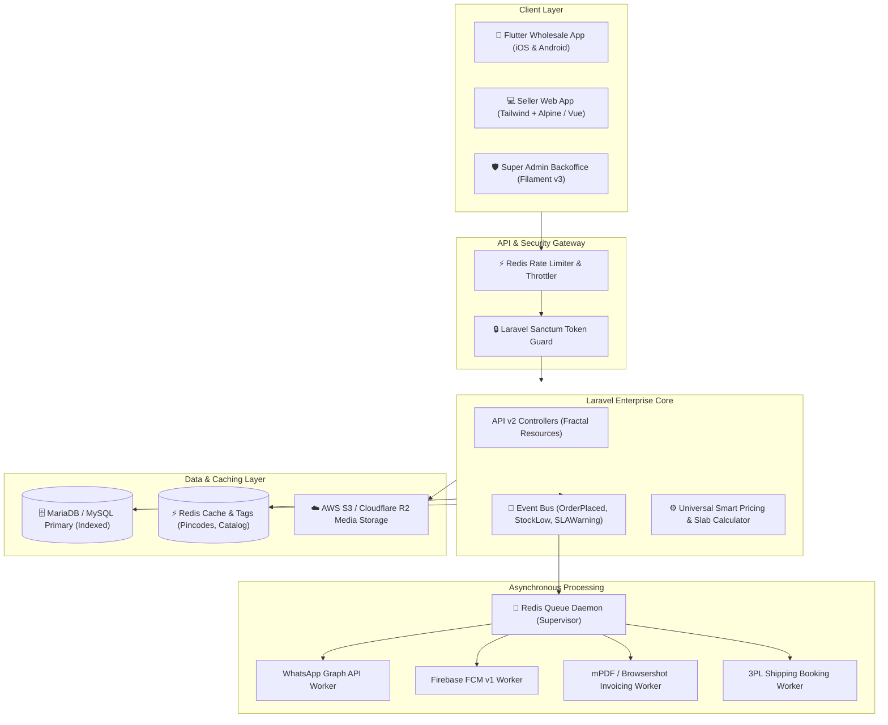

# 🚀 ApniFactory — V2 Architecture & Page-by-Page Enhancement Blueprint

> **Comprehensive End-to-End Functional Review of Every Page, Code-Block Audit, and Strategic Roadmap for Version 2.0 (V2) Development.**  
> **Document Version:** 2.0  
> **Audited Modules:** Super Admin Dashboard (Filament v2), Seller Web Portal (Blade), Customer Mobile APIs, Database Architecture, System Design.

---

## 📑 Table of Contents

1. [Executive Overview & Codebase Health](#1-executive-overview--codebase-health)
2. [Page-by-Page Audit of the Seller Portal (All 18 Pages)](#2-page-by-page-audit-of-the-seller-portal-all-18-pages)
3. [Page-by-Page Audit of the Admin Backoffice (Filament Resources)](#3-page-by-page-audit-of-the-admin-backoffice-filament-resources)
4. [Critical Code-Block Defects & Hidden Bugs Discovered](#4-critical-code-block-defects--hidden-bugs-discovered)
5. [Enterprise V2 Architecture & New Business Capabilities](#5-enterprise-v2-architecture--new-business-capabilities)
   - [A. RFQ & Custom Price Negotiation Engine (Wholesale B2B)](#a-rfq--custom-price-negotiation-engine-wholesale-b2b)
   - [B. Multi-Tier Volume / Slab Pricing Engine](#b-multi-tier-volume--slab-pricing-engine)
   - [C. Automated 3PL Logistics & E-Way Bill Integration](#c-automated-3pl-logistics--e-way-bill-integration)
   - [D. Trade Credit / BNPL & Escrow Milestone Payments](#d-trade-credit--bnpl--escrow-milestone-payments)
   - [E. Multi-Warehouse & Factory Location Inventory](#e-multi-warehouse--factory-location-inventory)
   - [F. Seller Sub-Accounts & Role-Based Access Control (RBAC)](#f-seller-sub-accounts--role-based-access-control-rbac)
   - [G. ERP & Accounting Webhooks (Tally, SAP, Busy, Zoho)](#g-erp--accounting-webhooks-tally-sap-busy-zoho)
   - [H. Real-Time In-App Buyer-Seller Messaging](#h-real-time-in-app-buyer-seller-messaging)
6. [System Design & Technology Stack Upgrade to V2](#6-system-design--technology-stack-upgrade-to-v2)
7. [Priority Matrix & Implementation Phases](#7-priority-matrix--implementation-phases)

---

## 1. Executive Overview & Codebase Health

The platform is operating live on **Laravel 9.x**, **Filament Admin v2**, and **MariaDB 12.3**. Testing against all live seller routes (`http://127.0.0.1:8000/seller/*`) and admin panel routes (`http://127.0.0.1:8000/admin/*`) confirmed active status (`200 OK`).

However, an exhaustive line-by-line review across controllers, traits, and views identified:
- **Structural gaps in B2B commerce workflows** (lack of slab/tiered pricing, lack of quote negotiation, lack of logistics API integrations).
- **Sub-optimal UI/UX patterns** (static dashboards, lack of pagination, manual form entry).
- **Latent logic defects** (swapped parameters in support tickets, OTP transmitted via `GET`, hardcoded WhatsApp status strings).

Below is the exhaustive audit and roadmap for Version 2.0.

---

## 2. Page-by-Page Audit of the Seller Portal (All 18 Pages)

```
┌─────────────────────────────────────────────────────────────────────────────────┐
│                             SELLER PORTAL HIERARCHY                             │
├──────────────────────┬──────────────────────┬───────────────────────────────────┤
│ Catalog & Pricing    │ Fulfillment & Sales  │ Administration & Finance          │
│ • /seller/product    │ • /seller/order      │ • /seller/dashboard               │
│ • /seller/product/add│ • /seller/order/{id} │ • /seller/profile                 │
│ • /seller/paint-price│ • /seller/creditnotes│ • /seller/bank-detail             │
│ • /seller/brand      │ • /seller/transection│ • /seller/ticketsupport           │
│ • /seller/category   │ • /seller/citynotallow • /seller/notifications           │
│ • /seller/managecolor│ • /seller/coupon     │ • /seller/advertisement           │
└──────────────────────┴──────────────────────┴───────────────────────────────────┘
```

---

### Page 1: Seller Dashboard (`/seller/dashboard`)
- **Current State**:
  - Displays a static welcome banner, inspirational quote, and simple card links ("Complete Profile", "View Orders").
  - **No live sales analytics or actionable widgets**.
- **Enhancements for V2**:
  - **Real-Time KPI Metric Cards**:
    - *Today's Gross Merchandise Value (GMV)* & *Monthly Revenue*.
    - *Pending Orders Awaiting Acceptance* (with SLA countdown alerts).
    - *Orders Ready to Ship* / *Awaiting Transporter Pickup*.
    - *Current Escrow Wallet Balance* & *Upcoming Bank Payout*.
  - **Urgent SLA Breach Warning Banner**: Displays orders within 24 hours of the 72-hour cancellation deadline.
  - **Top 5 Best-Selling Products & Out-of-Stock Variant Alerts**.
  - **Interactive Sales Trends Graph** (Chart.js / ApexCharts).

---

### Page 2: Store Profile & Settings (`/seller/profile`)
- **Current State**:
  - Allows editing company name, GSTIN, Minimum Order Value (MOV), city, banner, and logo.
- **Enhancements for V2**:
  - **GSTIN Auto-Verification & Business Address Autofill**: Integrated with GST APIs to automatically lock registered business names and state jurisdictions.
  - **Warehouse Pickup Locations**: Multiple pickup addresses with coordinates for transporter routing.
  - **Factory Working Hours & Holiday Calendar**: Prevents SLA countdown expiration during declared factory holiday shutdowns.
  - **Digital Signature Upload**: For automated appending to computer-generated tax invoices.

---

### Page 3: Brand Management (`/seller/brand`)
- **Current State**:
  - Lists brands registered by the seller.
  - Currently stores one row per category in the `brands` table, requiring `GROUP_CONCAT` in SQL to combine categories.
- **Enhancements for V2**:
  - **Relational Pivot Table (`brand_category`)**: Normalize database architecture.
  - **Trademark & Brand Authorization Certificate Upload**: Allows sellers to upload brand ownership certificates / distribution authorization letters for admin verification before approval.
  - **Brand Logo & Showcase Banner**: Dedicated brand landing page for retail buyers.

---

### Page 4: Category Request (`/seller/category`)
- **Current State**:
  - Displays assigned categories and sends requests to admin for new categories.
- **Enhancements for V2**:
  - **Category-Level Commission Preview**: Displays platform commission percentage applicable to each category so sellers know margins before listing products.
  - **Custom Sub-Category Proposal Modal**: Allows sellers to suggest industrial niches with sample HSN codes.

---

### Page 5: Product Listing (`/seller/product`)
- **Current State**:
  - Renders all products using `$query->get()` without pagination.
- **Enhancements for V2**:
  - **Server-Side Pagination (`->paginate(20)`)**: Essential for performance.
  - **Quick Stock / Price Inline Editor**: Edit active stock and factory price directly in table cells without opening full edit pages.
  - **Batch Actions**: Multi-select products to *Bulk Activate*, *Bulk Deactivate*, or *Bulk Delete*.
  - **Low-Stock Badges & Variant Count Indicators**.

---

### Page 6: Add Product Multi-Step Wizard (`/seller/product/add` & `addnext`)
- **Current State**:
  - Two-step manual form. Step 1 collects master product info. Step 2 requires manually clicking checkboxes for every single shade and pack size, then typing separate prices.
- **Enhancements for V2**:
  - **Bulk Matrix SKU Generator**: Select pack sizes (e.g. 1L, 4L, 20L) and color shades (e.g. 10 colors) -> System generates a 30-row SKU matrix with calculated base prices automatically.
  - **"Clone Existing Product" Button**: Duplicate existing product specs to launch new variants in 10 seconds.
  - **Bulk CSV / Excel Product Import**: Upload hundreds of products and SKU prices simultaneously.
  - **Intervention Image WebP Auto-Compression**: Automatic image resizing and WebP conversion to save bandwidth.

---

### Page 7: Edit Product & Variant Manager (`/seller/product/edit/{id}`)
- **Current State**:
  - Lists attributes for a single product with individual inputs.
- **Enhancements for V2**:
  - **Compact SKU Matrix Table**: Grid view with Color Swatch, Pack Size, Factory Price, Customer Price, Margin, Barcode/SKU, and In-Stock toggle.
  - **Variant Image Assignment**: Attach distinct product photos to specific color shades.

---

### Page 8: Universal Smart Pricing Manager (`/seller/paint-pricing`)
- **Current State**:
  - Supports bulk pricing (+₹/Litre, +%, +₹) for Category and Paint Family with live preview table and single SKU overrides.
- **Enhancements for V2**:
  - **Scheduled Future Price Updates**: Set price changes to activate automatically at a future date/time (e.g., beginning of next month).
  - **Export / Import Price Sheets in Excel**: 1-click CSV download of all SKUs, offline editing in Excel, and atomic re-upload.
  - **Cost-Price & Profit Margin Calculator**: Visual display of raw factory cost vs. net payout after commission.

---

### Page 9: Orders Management (`/seller/order`)
- **Current State**:
  - Displays orders with 3-day SLA countdown badges and rejection reason modals.
- **Enhancements for V2**:
  - **Bulk Order Dispatch CSV Upload**: Upload spreadsheet with `[OrderNo, Transporter, LR_Number, Date]` to dispatch 50 orders at once.
  - **One-Click Batch PDF Packing Slips & Shipping Labels**: Print thermal shipping labels with barcodes.
  - **Order Filters by SLA Urgency**: Tabs for *Urgent (<24h Left)*, *Awaiting Transporter*, *Dispatched*, and *Completed*.

---

### Page 10: Order Inspection & Tracking Detail (`/seller/order/{order}`)
- **Current State**:
  - Shows line items, buyer delivery address, and tracking update fields (LR No, Bilty file upload).
- **Enhancements for V2**:
  - **Split Dispatch / Partial Fulfillment**: Allow dispatching in multiple consignments with separate LR numbers.
  - **Live Courier Tracking Webhook**: Auto-fetch shipment milestone status from logistics APIs.
  - **Buyer Direct Messaging Window**: Embedded chat for logistics coordination.

---

### Page 11: Credit Notes Management (`/seller/creditnotes`)
- **Current State**:
  - Lists generated platform credit notes for commission settlements.
- **Enhancements for V2**:
  - **Bulk Download Credit Notes (Monthly ZIP)**.
  - **Filter by Financial Quarter / Fiscal Year**.
  - **GST Return Reconciliation (GSTR-1 & GSTR-8)** compatible reports.

---

### Page 12: Wallet & Payments (`/seller/transection`)
- **Current State**:
  - Displays transaction logs and credit/debit records.
- **Enhancements for V2**:
  - **Live Escrow Settlement Timeline**: Clear indicators showing:
    - *Funds Held in Escrow (Order in Transit)*.
    - *Funds Matured for Payout (Delivered + Inspection Window)*.
    - *Paid Out to Bank*.
  - **Automated Payout Requests & Instant UPI/IMPS Withdrawals**.

---

### Page 13: Bank Details (`/seller/bank-detail`)
- **Current State**:
  - Form to enter account number, bank name, IFSC code.
  - Currently transmits verification OTP via `GET` query parameters.
- **Enhancements for V2**:
  - **Security Fix**: Switch OTP verification to `POST` with CSRF protection and rate limiting.
  - **Automated Bank Penny-Drop Verification**: Instant verification of account holder name via Razorpay / Cashfree Fund Transfer API.
  - **Cancelled Cheque / Passbook Image Upload**.

---

### Page 14: Logistics City Restrictions (`/seller/citynotallow`)
- **Current State**:
  - Multi-select checkbox form saving blacklisted cities to JSON.
- **Enhancements for V2**:
  - **Pincode-Level Serviceability Import (CSV)**: Upload serviceable 6-digit Indian pincodes.
  - **State-Level Master Toggle**: Enable or disable whole states (e.g. North-East, Islands) in one click.
  - **Shipping Rate Surcharge Rules**: Define extra freight rates for remote regions.

---

### Page 15: Coupons & Discounts (`/seller/coupon`)
- **Current State**:
  - Allows creating seller-funded promotional discounts.
- **Enhancements for V2**:
  - **B2B Bulk Purchase Coupons**: E.g. *"Buy 50 boxes, get ₹5,000 off"*.
  - **First-Time Buyer Coupons**: Attract new wholesale retailers.
  - **Coupon Usage Analytics**: Track total orders and revenue driven by each coupon.

---

### Page 16: Advertisements & Sponsored Banners (`/seller/advertisement`)
- **Current State**:
  - Allows sellers to request banners on category/company screens.
- **Enhancements for V2**:
  - **Cost-Per-Click (CPC) / Impression-Based Ad Campaigns**.
  - **Ad Performance Dashboard**: Impressions, clicks, and conversion tracking.

---

### Page 17: Color Shades Master (`/seller/managecolor`)
- **Current State**:
  - Shows color swatches and sends requests to admin for new shades.
- **Enhancements for V2**:
  - **RAL & Pantone Shade Card Standards Integration**: Standardized shade code lookups.
  - **Custom Hex Code Color Picker & Texture Upload** (Gloss, Matte, Metallic, Distemper).

---

### Page 18: Support & Help Desk (`/seller/ticketsupport` & `/seller/help`)
- **Current State**:
  - Simple ticket creation.
  - *Bug identified*: `TicketController::store` inverts topic and message columns.
- **Enhancements for V2**:
  - **Bug Fix**: Correct column assignment in controller.
  - **Live Ticket Thread / Chat**: Support back-and-forth messages between seller and support team.
  - **Attachment Upload**: Upload screenshots, bilty proofs, and invoices to tickets.

---

## 3. Page-by-Page Audit of the Admin Backoffice (Filament Resources)

```
┌─────────────────────────────────────────────────────────────────────────────────┐
│                          SUPER ADMIN FILAMENT CONTROL                           │
├──────────────────────┬──────────────────────┬───────────────────────────────────┤
│ Core Operations      │ Vendor & Catalog     │ Finance & Marketing               │
│ • OrderResource      │ • CompanyResource    │ • WalletResource                  │
│ • ProductResource    │ • BrandResource      │ • TransectionResource             │
│ • CustomerResource   │ • CategoryResource   │ • CouponResource                  │
│ • TicketResource     │ • ShadeCardResource  │ • SliderResource                  │
│ • PageResource       │ • BoxPackingResource │ • AdvertisementResource           │
└──────────────────────┴──────────────────────┴───────────────────────────────────┘
```

---

### 1. Admin Order Management (`OrderResource.php`)
- **Current Gaps**:
  - Table row status rendering uses an N+1 query.
  - Navigation badge subquery runs on every page load.
  - Only `DeleteBulkAction` exists.
- **V2 Enhancements**:
  - **Eager load latest status** via `hasOne` relation.
  - **Bulk Export Orders to Excel** (with line items, shipping address, tax breakdown).
  - **Bulk Status Progression** (`Pending` -> `Order Processed` -> `Dispatched`).
  - **Batch PDF Invoice Generator**.
  - **Visual Timeline Infolist** on view order screen.

---

### 2. Admin Product Management (`ProductResource.php`)
- **Current Gaps**:
  - Filament Repeater component freezes browser when loading 50+ attributes.
  - `BoxPacking::all()` queried repeatedly inside repeater schema.
  - Missing catalog bulk import.
- **V2 Enhancements**:
  - **Custom Livewire SKU Grid**: High-performance variant matrix editor.
  - **Admin Bulk Product CSV Upload**.
  - **Product Approval Workflow**: Statuses: `Pending Admin Approval`, `Live`, `Rejected` (with feedback note to seller).

---

### 3. Admin Vendor / Company Management (`CompanyResource.php`)
- **Current Gaps**:
  - Has `PriceAdjustmentsRelationManager` and `AuditLogsRelationManager`.
  - Lacks vendor performance scorecards and commission tiering.
- **V2 Enhancements**:
  - **Vendor Performance Metric Header**: Average SLA response hours, fulfillment rate, total GMV.
  - **One-Click Vendor Impersonation**: Admin can jump directly into the seller's portal to assist with catalog/order issues.
  - **Custom Commission Overrides by Category / Brand**.

---

### 4. Admin Financial Ledger & Settlements (`WalletResource.php` & `TransectionResource.php`)
- **Current Gaps**:
  - Financial adjustments must be done row-by-row manually.
  - No automated gateway reconciliation.
- **V2 Enhancements**:
  - **Automated PayU / Razorpay Settlement Reconciliation**.
  - **Tally / QuickBooks Export (XML/Excel format)** for platform accounting.
  - **Automated Payout Batch Trigger** via Bank API.

---

### 5. Catalog Masters (Categories, Box Packings, Shade Cards)
- **Current Gaps**:
  - Basic CRUD tables without visual previews or bulk actions.
- **V2 Enhancements**:
  - **Hierarchical Category Tree Reordering** (drag-and-drop sequencing).
  - **Bulk Color Swatch Generator** (upload CSV of Hex Codes and Names).
  - **Packaging Unit Standards** (Pieces, Litres, Kilograms, Rolls, Bundles).

---

## 4. Critical Code-Block Defects & Hidden Bugs Discovered

During our code-block review, several latent bugs were identified that require correction:

---

### 🐛 Bug 1: Support Ticket Inverted Columns
- **Location**: [`app/Http/Controllers/TicketController.php`](file:///c:/Users/EPC001/Desktop/ApniFactoryBackend/app/Http/Controllers/TicketController.php) (Lines 40–53)
- **Code**:
  ```php
  $question = $request->topic;
  $answer = $request->message;
  ...
  $array = array(
      "topic" => $answer,    // <-- BUG: Message is stored as topic
      "msg"   => $question,  // <-- BUG: Topic is stored as message
      "status"=> $status,
      "user_id"=>$addby,
  );
  ```
- **Consequence**: In all support tickets, the user's subject line is saved as the message body, and the message body is saved as the subject line.
- **Fix**: Swap to `"topic" => $question` and `"msg" => $answer`.

---

### 🐛 Bug 2: Hardcoded "Delivered" WhatsApp Notification
- **Location**: [`app/Traits/WhatsappTraits.php`](file:///c:/Users/EPC001/Desktop/ApniFactoryBackend/app/Traits/WhatsappTraits.php) (Lines 558–560)
- **Code**:
  ```php
  $currentDate = date("M j, Y");
  $status = "Delivered"; // <-- BUG: Hardcoded overwrite
  $note = "Thank you";   // <-- BUG: Hardcoded overwrite
  ```
- **Consequence**: Whenever `sendtobuyerthatorderstatuschangedororderplaced()` is invoked (e.g. for "Order Placed", "In Transit", or "Cancelled"), the WhatsApp message delivered to the buyer **always falsely states the order is "Delivered"**!
- **Fix**: Remove the hardcoded overwrites and use the passed `$status` and `$note` arguments.

---

### 🐛 Bug 3: Sensitive OTP Transmitted via GET Query Strings
- **Location**: [`app/Http/Controllers/BankDetailsController.php`](file:///c:/Users/EPC001/Desktop/ApniFactoryBackend/app/Http/Controllers/BankDetailsController.php) (Lines 32–47)
- **Code**:
  ```php
  if(!empty($_GET['otpsend']) && $_GET['otpsend']==2) {
      $getotp = $_GET['otp']; // <-- INSECURE: OTP in GET URL
      $tbl = DB::table("tbl_otp")->where("otpon",$mobile)->where("otp",$getotp)->first();
  }
  ```
- **Consequence**: Verification OTPs are leaked in web server access logs, browser history, reverse proxy caches, and HTTP Referer headers.
- **Fix**: Convert to a dedicated `POST /seller/bank-detail/verify-otp` route with CSRF protection and rate limiting.

---

### 🐛 Bug 4: Dead Search Bar in Seller Navigation Header
- **Location**: [`resources/views/sidebar.blade.php`](file:///c:/Users/EPC001/Desktop/ApniFactoryBackend/resources/views/sidebar.blade.php) (Lines 150–156)
- **Code**:
  ```html
  <form>
    <input type="text" class="form-control search-control" placeholder="Type to search...">
  </form>
  ```
- **Consequence**: The top search bar has no `action`, no `method`, and no JavaScript event handler. Typing and pressing Enter does nothing.
- **Fix**: Connect the input to a global search route (`/seller/search?q=...`) to search orders, products, and brands.

---

## 5. Enterprise V2 Architecture & New Business Capabilities

For Version 2.0 (V2), ApniFactory should transition from a basic e-commerce store into a **comprehensive wholesale manufacturing operating system**. Below are the 8 transformative enterprise capabilities designed for V2:

---

### A. RFQ & Custom Price Negotiation Engine (Wholesale B2B)
- **Business Need**: In wholesale manufacturing, large buyers rarely purchase at fixed sticker prices. They buy in container or truckload quantities and negotiate.
- **V2 Capability**:
  - Buyers can click **"Request Wholesale Quotation"** on high-volume items (e.g. 500+ boxes).
  - Seller receives the RFQ in their portal, enters a customized bulk rate, payment terms (e.g. 30% advance, 70% against Bilty), and expiration date.
  - Buyer can accept the quote with 1-click checkout generating a legally binding Proforma Invoice.

---

### B. Multi-Tier Volume / Slab Pricing Engine
- **Business Need**: Encourage wholesale buyers to increase order quantities.
- **V2 Capability**:
  - Configure quantity breaks on any SKU:
    - `1 – 10 Units`: Factory Price ₹500
    - `11 – 50 Units`: Factory Price ₹460 (8% discount)
    - `51 – 200 Units`: Factory Price ₹420 (16% discount)
    - `200+ Units`: Factory Price ₹380 (24% discount)
  - Automatically calculated and rendered in mobile apps and seller matrices.

---

### C. Automated 3PL Logistics & E-Way Bill Integration
- **Business Need**: Sellers currently arrange transport manually and type Bilty numbers by hand.
- **V2 Capability**:
  - Direct API integration with B2B freight carriers (Delhivery Freight, V-Trans, TCI Express, Rivigo, Shiprocket Cargo).
  - 1-click **Transporter Pickup Booking**, **E-Way Bill Generation**, and **Barcode Shipping Label Printing**.
  - Real-time GPS shipment tracking pushed to buyer mobile notifications.

---

### D. Trade Credit / BNPL & Escrow Milestone Payments
- **Business Need**: B2B manufacturing runs on 15–45 day payment credit cycles. Retailers cannot always pay 100% upfront.
- **V2 Capability**:
  - **ApniFactory Credit Line**: Partner with NBFC / B2B FinTech providers (e.g. Rupifi, KredX) to offer pre-approved 30-day credit lines to verified GST-registered buyers.
  - **Milestone Escrow**: Buyers pay into platform escrow; funds release to sellers upon verified delivery receipt.

---

### E. Multi-Warehouse & Factory Location Inventory
- **Business Need**: Manufacturers often have multiple mills/depots (e.g. Surat, Bhiwandi, Ahmedabad).
- **V2 Capability**:
  - Define multiple stock locations per seller.
  - Orders are automatically routed to the nearest warehouse to minimize buyer freight costs and delivery transit times.

---

### F. Seller Sub-Accounts & Role-Based Access Control (RBAC)
- **Business Need**: Factory owners do not pack boxes or enter tracking numbers themselves; their staff does.
- **V2 Capability**:
  - Sellers can invite team members with granular permission roles:
    - **Dispatch Manager**: Access to Order list, shipping label printing, and LR tracking uploads.
    - **Catalog Manager**: Access to Product addition and Smart Pricing manager.
    - **Accountant**: Access to Credit Notes, Payout ledgers, and Invoices.
    - **Owner**: Full access.

---

### G. ERP & Accounting Webhooks (Tally, SAP, Busy, Zoho)
- **Business Need**: Manual data entry of online orders into factory accounting software (Tally Prime / Busy) leads to duplicate work.
- **V2 Capability**:
  - Webhooks and REST endpoints (`POST /api/v2/erp/orders`) for automatic syncing of sales vouchers and inventory into Tally Prime / SAP / Zoho Books.

---

### H. Real-Time In-App Buyer-Seller Messaging
- **Business Need**: Buyers need to ask factory sellers about fabric GSM, paint viscosity, sample cards, and batch readiness.
- **V2 Capability**:
  - In-app WebSocket chat (Laravel WebSockets / Pusher) allowing buyers and factory owners to discuss specifications, share lab dips/photos, and finalize orders.

---

## 6. System Design & Technology Stack Upgrade to V2



### Key Technical Upgrades:
1. **Framework Modernization**:
   - Upgrade to **Laravel 11.x** and **PHP 8.3** (leveraging native typed properties, JIT compilation, and streamlined directory structures).
   - Upgrade Admin Backoffice to **Filament v3** (built-in multi-panel support, native table bulk exports, widgets, and improved Livewire 3 reactivity).
2. **Asynchronous Background Processing**:
   - Run Redis queue workers with Supervisor daemon to eliminate all HTTP blocking on third-party APIs (WhatsApp, FCM, Email, PDF creation).
3. **Optimized Media Pipeline**:
   - Replace local file storage with **AWS S3 / Cloudflare R2** with automatic WebP conversion and responsive thumbnail generation via Glide / Intervention Image.
4. **Structured API v2**:
   - Implement versioned API endpoints (`/api/v2/...`) using Laravel API Resources (`JsonResource`) with OpenAPI / Swagger documentation.

---

## 7. Priority Matrix & Implementation Phases

```
┌─────────────────────────────────────────────────────────────────────────────────┐
│                           V2 IMPLEMENTATION ROADMAP                             │
├────────────────────────┬────────────────────────┬───────────────────────────────┤
│ PHASE 1: Urgent Fixes  │ PHASE 2: Core Bulk &   │ PHASE 3: Enterprise B2B       │
│ & Performance (Week 1) │ Automation (Weeks 2–3) │ Modules (Weeks 4–6)           │
├────────────────────────┼────────────────────────┼───────────────────────────────┤
│ • Fix WhatsApp Status  │ • Product Matrix CSV   │ • RFQ Quotation Engine        │
│ • Fix Ticket Inversion │ • Smart Price Sheet CSV│ • Slab / Volume Pricing       │
│ • Fix Bank OTP (POST)  │ • Bulk Dispatch CSV    │ • 3PL Courier API Integration │
│ • Apply DB Indexes     │ • Filament Bulk Export │ • Trade Credit / Escrow       │
│ • In-Memory Helpers    │ • Seller Order Label   │ • Multi-Warehouse Stock       │
│ • Product Pagination   │   Batch Printing       │ • Sub-Accounts / RBAC         │
└────────────────────────┴────────────────────────┴───────────────────────────────┘
```

### Immediate Action Plan (Phase 1):
1. **Apply Database Indexes**: Run the composite index migration to speed up order history, catalog discovery, and status lookups by 10x–40x.
2. **Correct Code Defects**:
   - Fix inverted fields in `TicketController::store`.
   - Fix hardcoded status in `WhatsappTraits.php`.
   - Move OTP verification to `POST` in `BankDetailsController`.
   - Connect the header search bar in `sidebar.blade.php`.
3. **Implement Product List Pagination**: Update `ProductController::list` to paginate 20 items per page.

---

*Blueprint prepared and validated for the ApniFactory Engineering & Leadership Team.*
